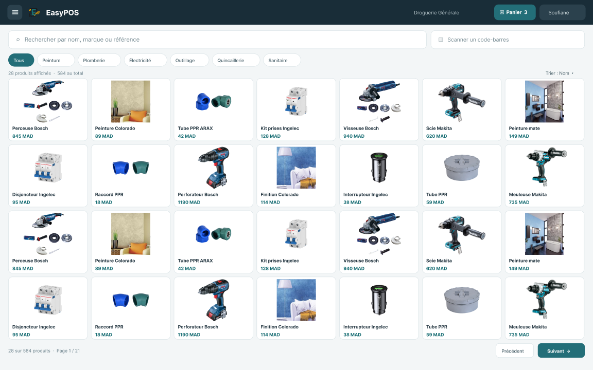

# EasyPOS

EasyPOS is an open-source desktop point-of-sale system for hardware, plumbing, paint, electrical, and general retail shops. It includes a photo-led checkout, barcode lookup, customers, suppliers, receiving, stock movements, reports, and a phone interface for adding products and making sales.

**[Download for Windows](https://github.com/frnaky-op/EasyPOS/releases/latest)** · **[User guide (French)](https://frnaky-op.github.io/EasyPOS/guide.html)** · **[Project website](https://frnaky-op.github.io/EasyPOS/)**



*Design preview with sample products and prices. The installed app uses your own catalogue and selected theme.*

## What you can do

| Area | Capabilities |
| --- | --- |
| Checkout | Search by name or barcode, browse product photos, use a cart, take cash or card payments, print receipts, and review sales. |
| Catalogue | Manage products, categories, prices, photos, suppliers, and stock thresholds. Select products to export a barcode-sheet PDF. |
| Inventory | Decrease stock after paid sales, increase it with supplier receipts, record adjustments and movements, and identify low-stock products. |
| Mobile | Pair a phone on the same Wi-Fi, photograph barcodes, create or edit products, and use the mobile cart and checkout. |
| Administration | Manage customers, suppliers, staff permissions, local backups, catalogue ZIP imports, updates, language, and themes. |

The interface supports French, Arabic with right-to-left layout, and English. Five color themes are available in **Settings → Appearance**.

## Requirements

- **Installed app:** Windows x64. Download the latest `EasyPOS-Setup-<version>-x64.exe` from [Releases](https://github.com/frnaky-op/EasyPOS/releases/latest).
- **Phone access:** A phone browser with a camera, on the same trusted Wi-Fi as the PC. EasyPOS must remain open on the PC. A barcode reader and receipt printer are optional.
- **From source:** Node.js 22 and npm on Windows. The release and CI workflows use Node.js 22.

EasyPOS stores shop data locally. Internet access is needed to download installers or updates. The phone interface is served over local HTTP on port **3211**; this local connection is not encrypted. See the [mobile setup notes](mobile/README.md) for camera and network details.

## Install and make a first sale

1. Download and run the latest Windows installer.
2. Sign in with the initial `admin` / `admin` account and change its password immediately.
3. Configure the store name, address, currency, and receipt details.
4. Create a category and product with a price and starting quantity, or import a catalogue ZIP with images.
5. Open **Caisse**, find the product by photo, name, or barcode, add it to the cart, and confirm the payment.
6. Check **Stock** and **Ventes & rapports**, then create a backup ZIP in **Paramètres → Données & sauvegardes**.

The illustrated [step-by-step user guide](https://frnaky-op.github.io/EasyPOS/guide.html) covers supplier receiving, the mobile interface, barcode sheets, backups, updates, and troubleshooting.

## Mobile catalogue and checkout

On the PC, click **Accès mobile** in the header. Open the displayed local address on a phone connected to the same Wi-Fi, then enter the eight-digit pairing code. You can take a photo of a barcode, add or edit the product, or open **Caisse** on the phone. Mobile checkout reads current prices from the local database and checks stock before recording a paid sale.

The pairing code changes when EasyPOS restarts; sessions expire after 12 hours. See [mobile/README.md](mobile/README.md) for details.

## Run from source

From a Windows terminal in the project directory:

```sh
npm ci
npm test
npm run start
```

`npm run start` runs the source app and does not install updates. The internal package name remains `PharmaSpot` so existing local installations keep using their current data directory.

## Updates and backups

Installed NSIS builds can check for a new version in **Paramètres → Mises à jour**. When the download is ready, choose **Installer et redémarrer**. Older Forge/Squirrel installations need one manual installation of an NSIS release before in-app updates work. Create a backup ZIP before changing installers or restoring data.

The [release guide](RELEASING.md) explains how maintainers version, build, and publish installers. The local `products/` catalogue and `design/` exports are excluded from Git because they contain third-party images and working data. Import your own catalogue into each installation.

## Project and attribution

This project is a fork of [PharmaSpot](https://github.com/drkNsubuga/PharmaSpot). The original project, Git history, and contributors remain credited under the [MIT license](LICENSE). The application and installer are branded EasyPOS, while the internal package name remains `PharmaSpot` for data compatibility.

Contributions are welcome through issues and pull requests; see [CONTRIBUTING.md](CONTRIBUTING.md).
